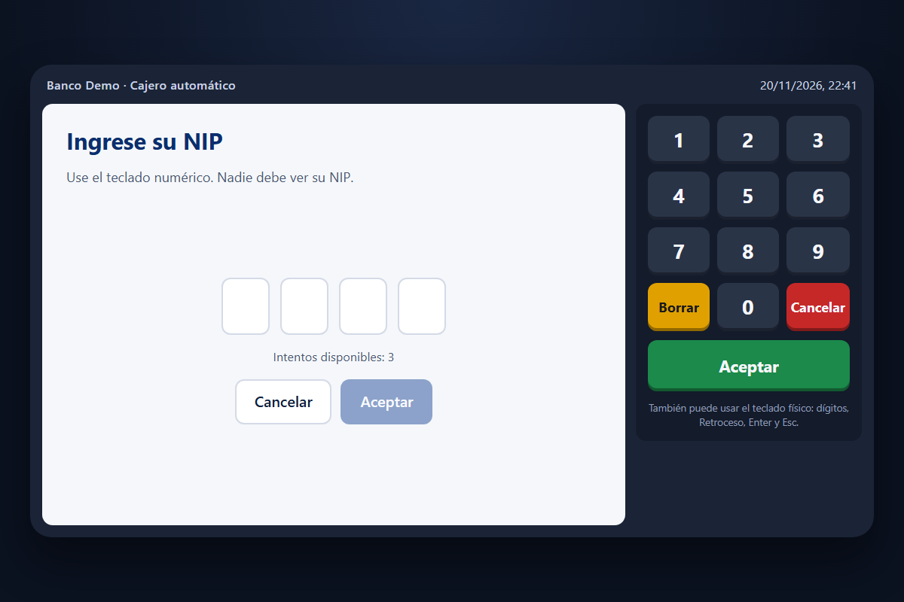
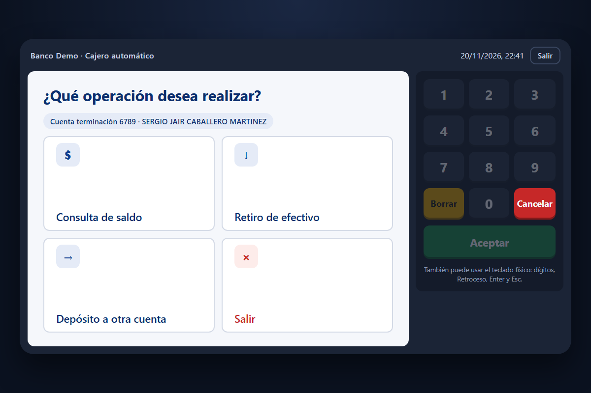
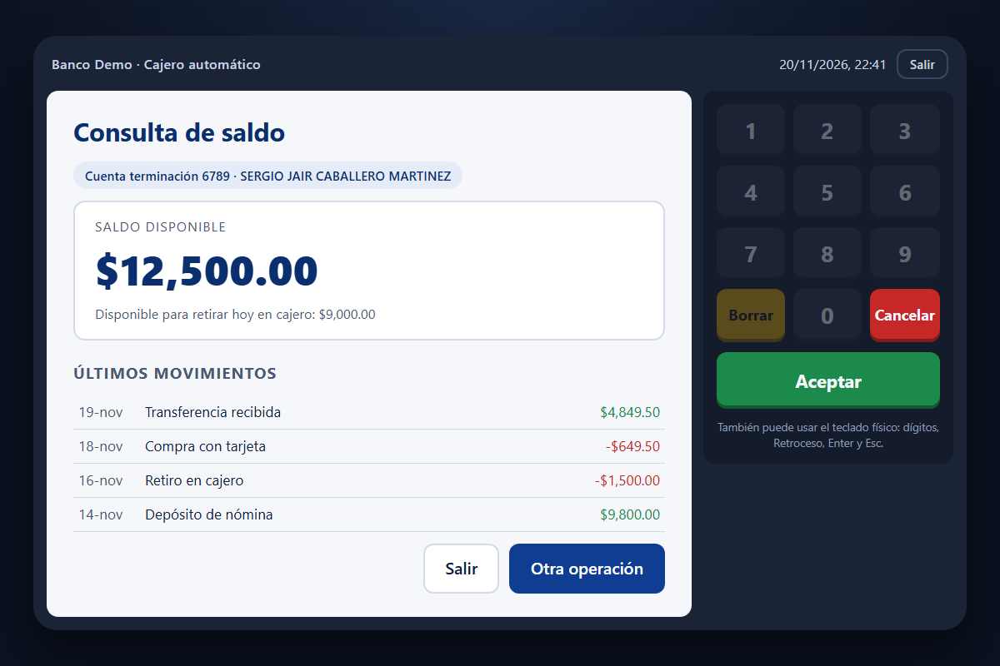
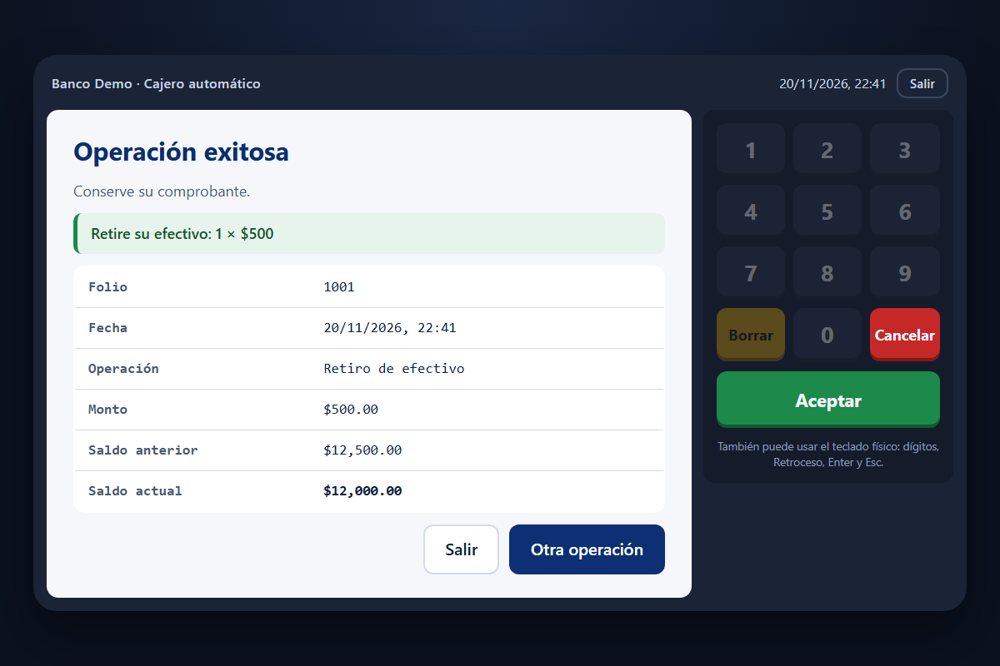
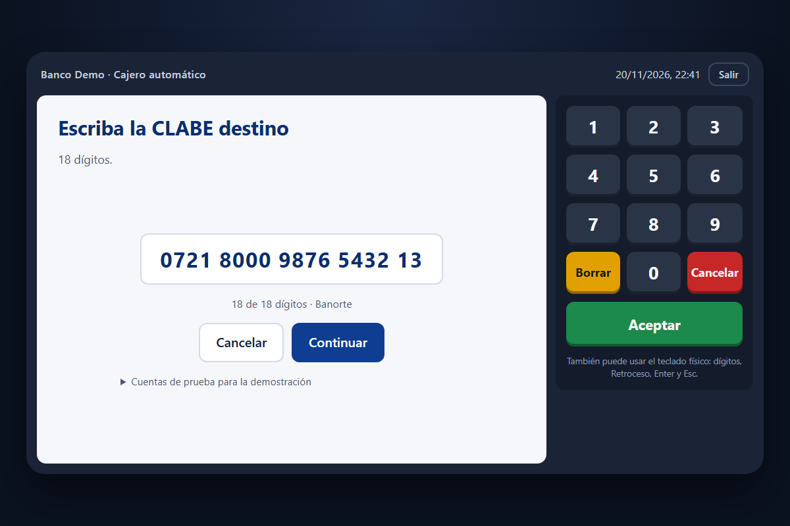
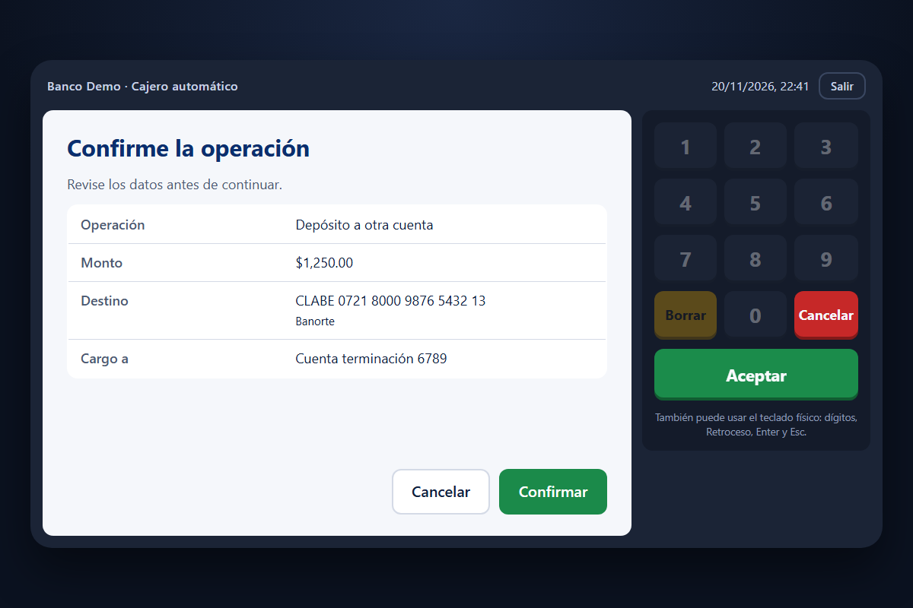

# Examen 1: interfaz gráfica de un cajero automático

Aplicación web que simula la pantalla y el teclado de un cajero automático. Implementa las cuatro funciones pedidas en el examen:

| Función | Dónde |
|---|---|
| a) Ingreso al sistema (NIP 8420) | Pantalla "Ingrese su NIP", 3 intentos y bloqueo de tarjeta |
| b) Consulta de saldo | Saldo disponible, disponible para retirar hoy y últimos 5 movimientos |
| c) Retiro de efectivo | Montos rápidos u otro monto; múltiplos de 100, límites por operación y por día, desglose de billetes |
| d) Depósito a otra cuenta | Por CLABE (18 dígitos, dígito verificador) o tarjeta (16 dígitos, Luhn); se carga a la cuenta del titular |

Documentos del examen:

- [docs/JUSTIFICACION.md](docs/JUSTIFICACION.md): justificación de cada decisión de diseño e implementación.
- [docs/PROMPTS.md](docs/PROMPTS.md): prompts usados para generar la aplicación.

## Cómo ejecutarla

Tres formas, de la más simple a la más completa:

1. **En línea (GitHub Pages):** https://sergiocaballeroo.github.io/examen1-cajero/
2. **Sin instalar nada:** descargar el repositorio (Code > Download ZIP), descomprimir y abrir `index.html` con doble clic. No necesita servidor ni conexión.
3. **Con servidor local** (opcional, por ejemplo para probar en el celular):
   ```
   npx serve .
   ```

Requisitos: cualquier navegador moderno (Chrome, Edge, Firefox, Safari). No hay dependencias ni paso de compilación.

## Datos de prueba

| Dato | Valor |
|---|---|
| NIP | `8420` (fijado por el examen) |
| Saldo inicial | $12,500.00 MXN |
| Cuenta del titular | terminación 6789, CLABE `012180001234567899`, tarjeta `4152313412344827` |
| CLABE destino válidas | `072180009876543213` (Banorte), `014180005555666677` (Santander), `002180001122334458` (Citibanamex) |
| Tarjetas destino válidas | `5471234567890128` (Mastercard), `4024000012345678` (Visa) |

Las cuentas de prueba también aparecen dentro de la app, en el desplegable "Cuentas de prueba para la demostración" de la pantalla de depósito. El enlace "Restablecer demostración" de la pantalla inicial regresa el saldo, los movimientos y el bloqueo a su estado original.

## Reglas de operación (como en un banco real)

- NIP de 4 dígitos, oculto en pantalla. Tres intentos fallidos retienen la tarjeta.
- Retiro: múltiplos de $100, mínimo $100, máximo $6,000 por operación y $9,000 por día. El cajero entrega billetes de 500, 200 y 100.
- Depósito a otra cuenta: hasta $20,000 por operación, nunca mayor al saldo, nunca a la propia cuenta. La CLABE se valida con el algoritmo oficial (ponderaciones 3-7-1) y el banco se identifica por sus tres primeros dígitos; la tarjeta se valida con Luhn.
- Toda operación que mueve dinero pide confirmación y entrega un comprobante con folio.
- La sesión se cierra sola tras 60 segundos sin actividad, con aviso 15 segundos antes.
- El saldo y los movimientos se guardan en el navegador (localStorage), así que sobreviven a recargas.

## Uso con teclado

Además de los botones en pantalla funciona el teclado físico: dígitos, Retroceso (borrar), Enter (aceptar) y Esc (cancelar). Todos los controles son accesibles con Tab y el foco es visible.

## Estructura

```
index.html            Estructura: barra superior, pantalla, teclado numérico y aviso de inactividad
css/estilos.css       Estilos tipo kiosco, responsivos
js/validaciones.js    CLABE (dígito verificador y catálogo de bancos), Luhn, formato de moneda
js/banco.js           Reglas de negocio, cuenta simulada, persistencia en localStorage
js/app.js             Máquina de estados de la interfaz, teclado, inactividad, comprobantes
scripts/pruebas.mjs   32 pruebas funcionales con Playwright (ver sección Pruebas)
evidencias/capturas/  Capturas de cada pantalla, generadas por las pruebas
docs/                 Justificación y prompts
```

## Capturas

| Ingreso | Menú |
|---|---|
|  |  |

| Saldo | Comprobante de retiro |
|---|---|
|  |  |

| Depósito: CLABE | Confirmación de depósito |
|---|---|
|  |  |

## Pruebas

```
npm install
npx playwright install chromium
npm test
```

El script recorre los cuatro flujos con Chromium sin interfaz, verifica las reglas (NIP incorrecto, múltiplos, límites diarios, CLABE con dígito verificador incorrecto, tarjeta que no pasa Luhn, saldo insuficiente, bloqueo, persistencia, vista móvil sin desplazamiento horizontal) y regenera las capturas. Para probar el sitio publicado: `BASE=https://sergiocaballeroo.github.io/examen1-cajero/ npm test`.

## Autor

Sergio Jair Caballero Martínez. Computación Gráfica e Interacción Humano Computadora, Facultad de Ingeniería, UNAM. Noviembre de 2026.
